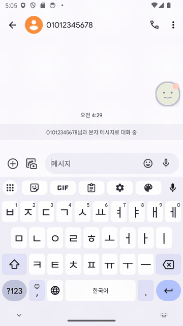
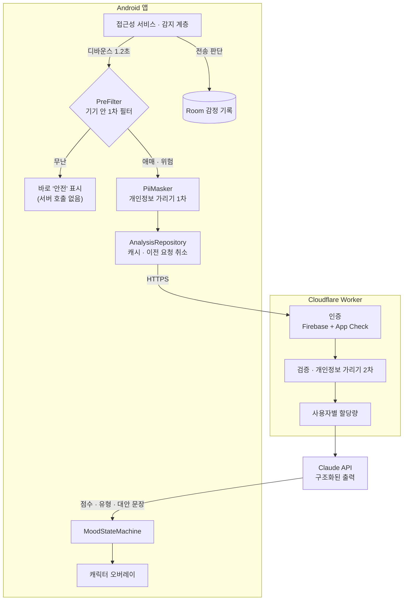
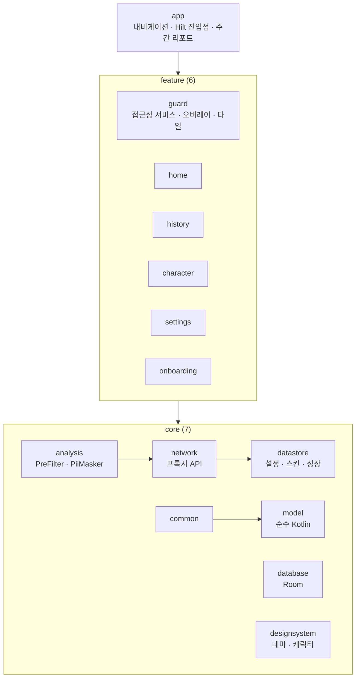

# 감정 가드 (EmotionGuard) v2

[](https://github.com/sungsik1093/emotion-guard/actions/workflows/ci.yml)

메신저에 글을 쓰는 동안 화면 구석의 작은 캐릭터가 문장의 감정 온도에 따라 표정과 색을 바꾸고, 상처가 될 수 있는 말이면 **보내기 전에** 더 나은 표현을 제안하는 안드로이드 앱입니다.

<p align="center">
  
</p>
<p align="center"><sub>에뮬레이터 + 테스트 모드(Claude 대신 규칙 기반 가짜 분석기) 시연</sub></p>

| 폴더 | 내용 |
| --- | --- |
| [android/](android/) | 안드로이드 앱 (Kotlin · Jetpack Compose · Hilt · 멀티 모듈) |
| [server/](server/) | API 프록시 서버 (Cloudflare Workers · TypeScript) — Claude API 키를 앱 대신 보관 |
| [docs/DESIGN.md](docs/DESIGN.md) | 설계 문서 (v1 한계와 해결, 화면 흐름, 구조, 캐릭터 시스템, 서버, 보안) |

## 핵심 기능

- **VPN처럼 켜고 끄기**: 홈의 큰 토글, 상단바 빠른 설정 타일, 상태 알림의 [끄기]
- **떠 있는 캐릭터**: 대기 · 생각 중 · 안전 · 주의 · 위험 · 칭찬 · 오프라인, 7가지 표정과 색. 드래그로 옮기고 탭하면 경고 카드
- **캐릭터 꾸미기**: 기본 캐릭터(코드로 그린 얼굴) 또는 내 사진. 사진 한 장 또는 상태별 사진, 언제든 기본값으로
- **대화 맥락 반영**: 채팅방 최근 대화 최대 8줄을 함께 보고 판단 (말풍선 뷰 ID → 위치 추정 순)
- **대안 문장**: "대안으로 바꾸기"를 누르면 입력창 내용이 바로 바뀌고 캐릭터가 칭찬
- **감정 기록**: 주간/월간 하루 평균 차트, 유형별 횟수, 경고 횟수, 바꿔 보낸 비율
- **개인정보 보호**: 기기 안 1차 필터(무난한 문장은 전송 안 함), 전화번호·계좌번호 등 가리기(앱+서버), 원문 저장 기본 꺼짐

## 구조

### 분석 흐름

메신저 입력이 멈추면 기기 안에서 먼저 거르고, 꼭 필요한 문장만 개인정보를 가린 뒤 서버로 보냅니다. Claude API 키는 서버에만 있습니다.



### 모듈 구조

의존 방향은 `app → feature → core`이고, feature끼리는 서로 모릅니다. (실제 `build.gradle.kts` 기준)



- 분석을 부르는 건 `guard`(실시간 감지)와 `home`(바로 테스트) 두 곳뿐이고, 나머지 feature는 `database`·`datastore`만 씁니다.
- `model`은 Android 의존성이 없는 순수 Kotlin 모듈이라 JVM에서 바로 테스트합니다.

## 빠르게 실행해 보기 (비용 0원)

Claude를 부르지 않는 **테스트 모드**로 앱 전체 흐름을 볼 수 있습니다.

1. 서버를 테스트 모드로 켭니다.
   ```bash
   cd server
   npm install
   cp .dev.vars.example .dev.vars   # MOCK_ANALYSIS=true, AUTH_MODE=dev, DEV_KEY 설정
   npm run dev
   ```
2. `android/local.properties`에 같은 개발 키를 넣습니다.
   ```properties
   PROXY_BASE_URL=http://10.0.2.2:8787/
   DEV_KEY=<server/.dev.vars의 DEV_KEY와 같은 값>
   ```
3. Android Studio에서 `android/` 폴더를 열고 에뮬레이터에서 실행합니다.
4. 온보딩을 마치고 홈 → **여기서 바로 테스트해보기**에서 문장을 넣어 보세요.

실제 AI 분석은 `server/.dev.vars`에 `ANTHROPIC_API_KEY`를 넣고 `MOCK_ANALYSIS=false`로 바꾸면 됩니다. 배포는 [server/README.md](server/README.md)를 참고하세요.

## 테스트

```bash
cd android && ./gradlew testDebugUnitTest :core:model:test   # 앱 단위 테스트
cd server && npm test                                         # 서버 단위 테스트
```

## 기술

**앱**: Kotlin 2.2 · Jetpack Compose (Material 3) · Hilt · Coroutines/Flow · Room · DataStore · Retrofit + kotlinx.serialization · Coil 3 · Firebase Auth/App Check · AccessibilityService · WindowManager 오버레이 · Quick Settings Tile

**서버**: TypeScript · Cloudflare Workers · Durable Objects · 공식 Anthropic SDK (`@anthropic-ai/sdk`) · zod · jose · vitest
